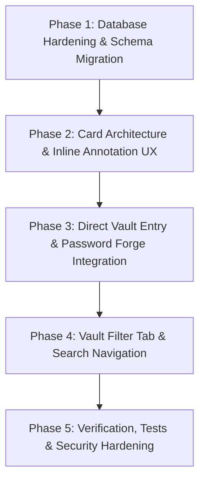

# Implementation Plan: Encrypted Vault Annotations & Simple Password Manager

> **Objective:** Transform `CipherClipboard` into a lightweight, delightful, and highly secure personal secret manager and password vault by adding encrypted annotations, item pinning (immunity from pruning and bulk clearing), direct non-clipboard credential entry, and label-based search.

---

## 1. Architectural Strategy & Security Invariants

### 1.1 Zero Overhead Encryption via SQLCipher
Because the SQLite database is encrypted at the page level using **SQLCipher (AES-256-CBC with HMAC-SHA512)**:
- Any new column added to `clipboard_history` (e.g. `label TEXT`, `notes TEXT`) is **automatically encrypted on disk**.
- No application-level ciphertext management or bespoke key derivation is needed.
- In-memory representations of secret notes and values will be protected and zeroized on drop.

### 1.2 Confidentiality During Search
- **The Invariant:** Plaintext secret values MUST NEVER be exposed to raw substring queries or SQL `LIKE` wildcard scans.
- **The Design:** The search query will match against `label LIKE ?` and `notes LIKE ?`. For `ItemKind::Secret`, the encrypted secret `content` is excluded from search pattern matching, but its **annotation** is searchable. Searching `"github"` or `"vpn"` will instantly locate the card, while the secret itself remains masked (`•••• •••• •••• ••••`) until explicitly copied or revealed.

### 1.3 Direct Non-Clipboard Entry
- **The Threat:** Background clipboard snooping by malicious or untrusted applications running on the user's desktop.
- **The Solution:** A dedicated "New Vault Entry" modal dialog that writes credentials directly to the encrypted database without passing through the OS clipboard buffers (`NSPasteboard` / Windows clipboard / X11 selection).

---

## 2. Phased Implementation Roadmap



---

### Phase 1: Database Hardening & Schema Migration

**Primary Files:** [`src/db.rs`](file:///home/antigravity/BrunoO/clipboard/src/db.rs)

1. **Schema Migration:**
   - Add new columns to `clipboard_history`:
     - `label TEXT`: Short identifier (e.g., *"GitHub Work PAT"*, *"Home Wi-Fi"*).
     - `notes TEXT`: Optional multi-line context (e.g., username, recovery codes).
     - `is_pinned INTEGER NOT NULL DEFAULT 0`: Boolean flag (1 = Pinned / Vault item).
   - Add indexes for fast sorting and filtering:
     - `CREATE INDEX IF NOT EXISTS idx_clipboard_history_pinned ON clipboard_history(is_pinned, id DESC);`
   - Incorporate `ALTER TABLE` statements into the existing graceful migration loop in `Database::open` with duplicate column error suppression.

2. **Database API Additions:**
   - `set_item_annotation(&self, id: i64, label: Option<&str>, notes: Option<&str>) -> Result<(), DbWriteError>`
   - `toggle_item_pinned(&self, id: i64) -> Result<bool, DbWriteError>`
   - `insert_manual_secret(&self, secret: &str, label: Option<&str>, notes: Option<&str>, is_pinned: bool) -> Result<i64, DbWriteError>`

3. **Pruning & History Clearing Protection:**
   - **`prune_history`:** Update `DELETE FROM clipboard_history ...` to strictly exempt pinned items:
     ```sql
     WHERE is_pinned = 0 AND id NOT IN (
         SELECT id FROM clipboard_history ORDER BY id DESC LIMIT ?
     )
     ```
   - **`clear`:** Bulk clearing preserves pinned items by default:
     ```sql
     DELETE FROM clipboard_history WHERE is_pinned = 0;
     ```
     (with an explicit option or confirmation if the user truly wishes to wipe pinned vault items).

4. **Search Query Refinement:**
   - Update `search(&self, query: &str)` to evaluate `(label LIKE ? OR notes LIKE ?)` across all entries.
   - For `ItemKind::Secret`, match solely against `label` and `notes`. For other kinds, match against `(label OR notes OR content)`.

---

### Phase 2: Card Architecture & Inline Annotation UX

**Primary Files:** [`src/icons.rs`](file:///home/antigravity/BrunoO/clipboard/src/icons.rs), [`src/app/history_view.rs`](file:///home/antigravity/BrunoO/clipboard/src/app/history_view.rs)

1. **Icon Assets:**
   - Register `PUSH_PIN` (`mi::ICON_PUSH_PIN.codepoint`) and `EDIT` (`mi::ICON_EDIT.codepoint`) in [`src/icons.rs`](file:///home/antigravity/BrunoO/clipboard/src/icons.rs).

2. **Card Visual Hierarchy:**
   - When an item has a `label`, display it prominently as the card's **headline** in 13.5pt bold text:
     ```
     ┌────────────────────────────────────────────────────────┐
     │ 📌 GitHub Production PAT              [Secret] • 2m ago │
     │ •••• •••• •••• ••••                          [👁] [⎘] [✎]│
     │ user: dev@company.com                                  │
     └────────────────────────────────────────────────────────┘
     ```
   - If pinned, display an amber/gold pushpin icon (`📌`) on the card header.

3. **Action Triggers & Micro-Interactions:**
   - **Pin Button:** Icon button on the card action row to toggle pinned state with instant visual feedback.
   - **Edit Annotation Button (`✎`):** Clicking opens an inline editing card or lightweight popover with:
     - Title / Label input field
     - Multi-line Notes field
     - "Save (Enter)" / "Cancel (Esc)" buttons
   - **Keyboard Shortcut:** Pressing `F2` or `Cmd+E` / `Ctrl+E` on a selected card immediately initiates annotation editing.

---

### Phase 3: Direct Vault Entry ("New Secret") & Password Forge Integration

**Primary Files:** [`src/app/mod.rs`](file:///home/antigravity/BrunoO/clipboard/src/app/mod.rs), [`src/app/generator_view.rs`](file:///home/antigravity/BrunoO/clipboard/src/app/generator_view.rs)

1. **"New Secret" Modal Dialog:**
   - Accessible via a dedicated `+ New Secret` button in the top header or `Cmd+N` / `Ctrl+N`.
   - Fields:
     - **Label / Title** (e.g., *"AWS Root Password"*)
     - **Secret Value** (password field with bullet masking and show/hide eye toggle)
     - **Notes / Username** (optional multi-line text)
     - **Pin to Vault** checkbox (checked by default)
   - Action: Inserts directly into `Database` and refreshes history; **does not** touch OS clipboard buffers.

2. **Password Forge Integration:**
   - Add a **"Save to Vault"** button in [`src/app/generator_view.rs`](file:///home/antigravity/BrunoO/clipboard/src/app/generator_view.rs).
   - Generates the password, opens the "New Secret" dialog pre-filled with the generated password, and prompts for the label.

---

### Phase 4: Vault Filter Tab & Search Navigation

**Primary Files:** [`src/app/history_view.rs`](file:///home/antigravity/BrunoO/clipboard/src/app/history_view.rs), [`src/app/mod.rs`](file:///home/antigravity/BrunoO/clipboard/src/app/mod.rs)

1. **Dedicated Vault Tab:**
   - Add a `Pinned / Vault` filter tab (`ContentFilter::Vault` or `ContentFilter::Pinned`):
     - Displays count of all pinned/vault credentials.
     - Allows users to switch immediately from transient clipboard clutter into their curated password list.
2. **Search Refinements:**
   - Typing in the spotlight search bar matches labels instantly.
   - For example, typing `"aws"` filters directly to the pinned AWS secret, displaying its label, notes, and bullet-masked capsule.

---

### Phase 5: Verification, Tests & Security Hardening

1. **Database Unit Tests:**
   - Test schema migration with existing and new databases.
   - Test that `prune_history` never deletes pinned items even under aggressive item caps.
   - Test that `clear` preserves pinned entries.
   - Test annotation search (verifying that secret values are NOT leaked into query logs or matched via plain content search).
2. **UI & Micro-interaction Verification:**
   - Test inline editing flow and hotkey bindings (`F2`, `Cmd+N`).
   - Verify WCAG contrast standards for the pinned badge and annotation typography.
3. **Multiplatform Checks:**
   - Run `cargo fmt -- --check`.
   - Run `cargo clippy --all-targets --all-features -- -D warnings`.
   - Run `cargo test --all-targets`.

---

## 3. Milestones & Work Breakdown

| Milestone | Deliverables | Estimated Scope |
| :--- | :--- | :--- |
| **Milestone A** | **Database & Storage Core:** Schema migration (`label`, `notes`, `is_pinned`), prune immunity, clear protection, and label search queries. | ~150 lines in `src/db.rs` + tests |
| **Milestone B** | **Card UI & Annotations:** Prominent label headlines, pinned gold badge, inline edit popup (`F2`), and pin toggle button. | ~200 lines in `src/app/history_view.rs` |
| **Milestone C** | **Direct Entry & Forge Integration:** "New Secret" modal dialog (`Cmd+N`) and "Save to Vault" action in Password Forge. | ~180 lines in `src/app/` |
| **Milestone D** | **Vault Filter Tab & Polish:** Dedicated `Vault` filter tab, count badges, and end-to-end integration tests. | ~100 lines |

---

## 4. Confirmed Design Choices

1. **Vault Tab Integration:**
   - **Decision:** Upgrade the existing `Secrets` filter tab into a combined **`Vault`** tab (`ContentFilter::Vault`).
   - Displays all items with `is_pinned = 1` as well as all `ItemKind::Secret` entries.
   - Preserves the streamlined 7-tab bar geometry so tabs stay on a single line without crowding.
2. **Bulk Clear Protection:**
   - **Decision:** Automatically preserve all pinned items during "Clear All History".
   - Shows feedback toast: *"History cleared. Pinned items kept."*
   - Pinned items can only be deleted individually via their card's delete action.
