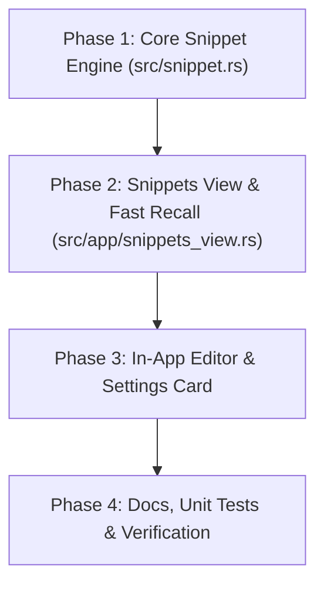

# Implementation Plan: Pre-Defined & User-Defined Snippets

> **Objective:** Add a lightweight, fast-recall **Snippets** library to `CipherClipboard` for reusable text and AI prompt templates (such as the Rhai script generator prompt, code-review prompts, and Copilot 365 templates), supporting both bundled starter snippets and user-authored snippets with lightweight dynamic placeholders (`{{clipboard}}`, `{{date}}`, `{{datetime}}`).

---

## 1. Design Principles & Security Boundaries

### 1.1 Clear Separation from Pinned History & Secrets
- **Pinned History (`is_pinned`):** Protects past clipboard captures from pruning and bulk clear; stays in the encrypted SQLCipher database.
- **Snippets:** Curated, editable, reusable templates (prompts, boilerplate, checklists, replies) that stay out of recency-ordered clipboard history.
- **Non-Secret Storage Boundary:** Snippets are stored as plain UTF-8 Markdown/text files in `<app_data>/snippets/` (mirroring `<app_data>/transforms/` for Rhai scripts) so users can edit them in any editor, version them in dotfiles, or manage them in-app. Because they are **not** SQLCipher-encrypted, the UI and docs must clearly state: *"Snippets are stored as plain files for reusable templates; store credentials and sensitive data as encrypted Secrets."*

### 1.2 Security & Platform Invariants (`AGENTS.md`)
- **Zero new dependencies:** Frontmatter parsing, slug sanitization, and placeholder expansion use pure safe Rust (`unsafe_code = "deny"`) + existing `jiff` for dates.
- **Owner-only permissions:** Create `<app_data>/snippets/` and write snippet files using `crate::platform::fs_security::{set_restricted_dir_permissions, set_restricted_permissions}`.
- **No path traversal:** Filenames generated from snippet titles are sanitized to `[a-z0-9_-].md` and verified to remain strictly inside `snippets_dir`.
- **Secret hygiene with `{{clipboard}}`:**
  - Never log expanded snippet contents.
  - When rendering a live hover/card preview for a snippet containing `{{clipboard}}`, if the newest clipboard entry is an unrevealed `ItemKind::Secret`, display `[MASKED SECRET]` in the preview instead of leaking the secret value.
  - If a snippet containing `{{clipboard}}` is expanded using a secret clipboard entry, treat the resulting copy as sensitive (or warn before expanding an unrevealed secret).
- **Bounded I/O & memory:** Cap loaded snippets at `256` files and `64 KiB` per file.

---

## 2. File Format & Starter Snippets

### 2.1 File Format (`<app_data>/snippets/*.md` or `*.txt`)
Optional lightweight frontmatter at the top of the file; plain files without frontmatter are also valid (the filename stem becomes the title):

```markdown
---
name: Generate CipherClipboard Rhai Script
category: AI & Prompt
description: Prompt template instructing an AI assistant to write a valid Rhai transform
tags: rhai, ai, script
---
Write a Rhai script (`.rhai`) for CipherClipboard's sandboxed text transformation engine...
```

### 2.2 Supported Placeholders
| Placeholder | Expansion |
|---|---|
| `{{clipboard}}` | Current clipboard text (or empty string if clipboard holds an image/empty) |
| `{{date}}` | Local date in `YYYY-MM-DD` (via `jiff::Zoned::now()`) |
| `{{datetime}}` | Local timestamp in `YYYY-MM-DD HH:MM` (via `jiff::Zoned::now()`) |

### 2.3 Bundled Starter Snippets (Seeded on First Creation of `snippets/`)
1. `rhai_script_prompt.md` — **Generate CipherClipboard Rhai Script** (`AI & Prompt`): The complete prompt from `README.md` with the Rhai API contract, built-in helpers, and Rhai gotchas.
2. `ai_code_review.md` — **AI Code Review (`{{clipboard}}`)** (`AI & Prompt`): Wraps the current clipboard snippet in a structured bug/edge-case/readability review prompt.
3. `copilot_summarize.md` — **Summarize for Copilot 365 (`{{clipboard}}`)** (`AI & Prompt`): Turns a copied email/Teams thread into key decisions, open questions, and action items.

*(Seeded only when `<app_data>/snippets/` does not exist yet so user deletions are respected; a **Restore Starter Snippets** button in Settings can recreate them anytime.)*

---

## 3. Phased Implementation Roadmap



---

### Phase 1: Core Snippet Engine (`src/snippet.rs`)

**Files:** `src/snippet.rs` (new), `src/main.rs` (`mod snippet;`)

1. **Data Model:**
   - `Snippet { filename, name, category, description, tags: Vec<String>, body, uses_clipboard: bool }`
   - `SnippetLoadError { filename, message }`
   - `SnippetRegistry { snippets_dir: PathBuf, snippets: Vec<Snippet>, errors: Vec<SnippetLoadError> }`
2. **Loader & Seeder:**
   - `SnippetRegistry::load_from_data_dir(data_dir: &Path) -> Self`
   - Creates `<data_dir>/snippets/` with `set_restricted_dir_permissions` and seeds the 3 starter snippets if the directory did not exist.
   - `reload(&mut self)` scans `*.md` and `*.txt` (sorted, capped at `256` files, `64 KiB` each), parses optional `---` frontmatter, and sorts by `(category, name)`.
   - `restore_starter_snippets(&mut self) -> Result<usize, std::io::Error>`
3. **CRUD Persistence:**
   - `save_snippet(&mut self, existing_filename: Option<&str>, name, category, description, tags, body) -> Result<String, String>`
     - Serializes clean frontmatter + body, generates a collision-free sanitized slug filename for new snippets, writes with `set_restricted_permissions`, and reloads.
   - `delete_snippet(&mut self, filename: &str) -> Result<(), String>`
     - Verifies `filename` is a single safe path component (no `/`, `\`, or `..`) before deleting and reloading.
4. **Placeholder Expansion:**
   - `expand_snippet(body: &str, clipboard_text: Option<&str>, now: jiff::civil::DateTime) -> String`
   - Single-pass replacement so clipboard contents containing `{{date}}` are never recursively re-expanded.

---

### Phase 2: Snippets View & Fast Recall (`src/app/snippets_view.rs`, `src/app/mod.rs`)

**Files:** `src/app/mod.rs`, `src/app/snippets_view.rs` (new)

1. **App State (`src/app/mod.rs`):**
   - Add `ActiveView::Snippets` alongside `History`, `Generator`, and `Settings`.
   - Add `snippet_registry: crate::snippet::SnippetRegistry` initialized from `&data_dir` in `ClipboardApp::new`.
   - Add `SnippetViewState { search_query, selected_category, selected_index, editor: Option<SnippetEditorState> }`.
   - Add a header tab/button (`Snippets`) next to Password Generator and Settings.
2. **Snippets List & Search (`src/app/snippets_view.rs`):**
   - Search bar (auto-focused when switching to Snippets) matching `name`, `category`, `tags`, `description`, and `body`.
   - Category filter pills (`All` + distinct categories present).
   - Keyboard navigation matching History: `↑`/`↓` to move selection, `Enter` to expand + copy + auto-paste (reusing `copy_text_to_clipboard` + auto-paste flow), `F2` to edit selected snippet, `Esc` to return to History.
   - Each card shows title, category pill, `{{clipboard}}` badge when applicable, description, and a compact preview of the body.
   - Clicking **Paste / Copy** (or pressing `Enter`):
     - If `snippet.uses_clipboard`: reads the latest text item (or current OS clipboard text), expands placeholders, and copies/auto-pastes; shows a clear warning toast if the clipboard is empty or holds an image.
     - Marks the write with the existing skip-capture mechanism or lets normal copy behavior apply consistently with transforms.

---

### Phase 3: In-App Editor & Settings Integration (`src/app/snippets_view.rs`, `src/app/settings_view.rs`)

**Files:** `src/app/snippets_view.rs`, `src/app/settings_view.rs`

1. **Create / Edit Snippet Modal (`src/app/snippets_view.rs`):**
   - **"+ New Snippet"** button in the Snippets toolbar; **Edit** and **Delete** buttons on each card.
   - Modal fields: Name, Category, Description, Tags, and multi-line Body (`TextEdit::multiline` in monospace) with clickable helper chips to insert `{{clipboard}}`, `{{date}}`, or `{{datetime}}`.
   - Subtle security reminder banner inside the editor: *"Stored as a plain file in `snippets/` — do not store passwords or API keys here."*
2. **Settings Card (`src/app/settings_view.rs`):**
   - Add **Snippets** card right next to **Custom Transform Scripts (Rhai)**:
     - Shows `<app_data>/snippets/` path, loaded snippet count, and any parse/load errors.
     - Buttons: **Reload Snippets**, **Restore Starter Snippets**, **Copy Folder Path**.

---

### Phase 4: Documentation, Unit Tests & Verification

**Files:** `src/snippet.rs`, `README.md`

1. **Unit Tests (`src/snippet.rs`):**
   - Starter snippet seeding on fresh temp dir + non-overwrite when dir already exists.
   - Frontmatter parsing (full frontmatter, partial frontmatter, plain `.md` without frontmatter, malformed frontmatter fallback).
   - Single-pass placeholder expansion (`{{clipboard}}`, `{{date}}`, `{{datetime}}`, verifying clipboard text containing `{{date}}` is not double-expanded).
   - Slug sanitization and path-traversal rejection (`../evil.md`, `/abs/path.md`).
   - CRUD roundtrip (`save_snippet` create → edit → `delete_snippet`) and file-size cap enforcement.
2. **Documentation (`README.md`):**
   - Add **Snippets** to Key Features, Project Structure (`src/snippet.rs`, `src/app/snippets_view.rs`), and a concise **Snippets** usage section explaining the folder path, frontmatter format, and placeholders.
3. **Pre-PR Verification:**
   ```bash
   cargo fmt -- --check
   cargo clippy --all-targets --all-features -- -D warnings
   cargo test --all-targets
   ```
